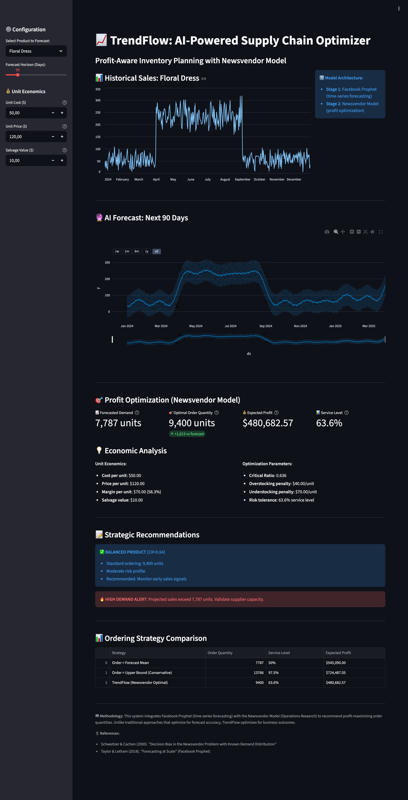
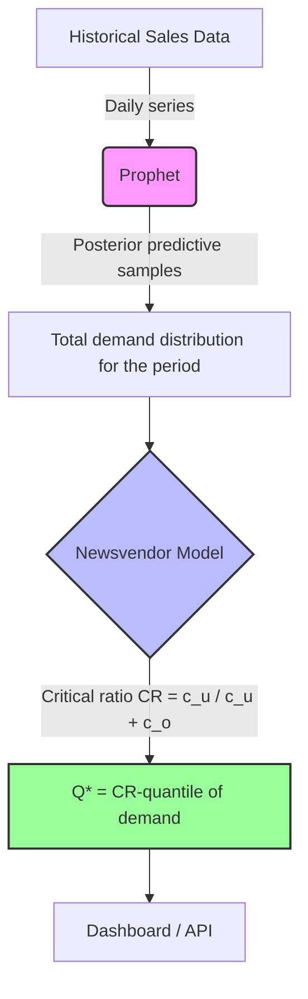

# 📈 TrendFlow: Profit-Aware Demand Forecasting for Fashion Retail

[](https://trendflow-ai-ejce3vtwm8zlggfnarjzps.streamlit.app/)
[](https://github.com/esraeslem/TrendFlow-AI/actions/workflows/main.yml)
[](https://www.python.org/)
[](https://streamlit.io/)
[](https://facebook.github.io/prophet/)
[](LICENSE)
[](https://github.com/esraeslem/TrendFlow-AI)

> 🚀 **[Live demo](https://trendflow-ai-ejce3vtwm8zlggfnarjzps.streamlit.app/)** · upload your own sales CSV or explore the synthetic data.
>
> Combines time-series forecasting (Prophet) with the newsvendor model from operations research to decide how much stock to order, not just how much will sell.

---

## 🎯 Abstract

Overstocking leads to markdowns; understocking leads to lost sales. **TrendFlow** forecasts daily demand with **Prophet**, turns the forecast into a full predictive distribution of demand for the planning period, and orders at the **newsvendor** optimum `Q* = F⁻¹(c_u / (c_u + c_o))`, the quantity that maximises expected profit given the cost of a lost sale versus the cost of a leftover unit.

### Highlights (from `python run_benchmark.py`, synthetic data)
- 📊 **+7.8% profit** versus ordering a 7-day moving-average forecast, reaching **97.9%** of the profit possible with perfect foresight. Most of this comes from Prophet's better forecast, not from the newsvendor step.
- ⚖️ **What the newsvendor step adds:** with symmetric margins, only **+0.03%** profit over ordering the Prophet mean; with asymmetric margins (critical ratio 0.17), **+3.9%**. Its main benefit is risk: the **stockout rate falls from 46% to 31%** at no cost in profit.
- 🧪 **Censored demand handled**: with 20% stockout days, treating stockout-day sales as missing lifts profit **+2.6%** and cuts stockout periods from 79% to 31%
- 📏 **Calibration audit**: Prophet's 95% intervals cover only 87.5% of 30-day totals, so its uncertainty is too narrow (documented, not hidden)
- 🖥️ Streamlit dashboard with a portfolio-level **executive summary**, CSV upload (e.g. H&M data) and a FastAPI service

---

## 🧠 The Problem

| Issue | Impact | Traditional Solution | Limitation |
|-------|--------|---------------------|------------|
| **Overstocking** | Markdowns, waste, capital tied up | Order less | Misses sales opportunities |
| **Understocking** | Lost sales, customer dissatisfaction | Order more | Excess inventory risk |
| **Seasonality** | Demand spikes (e.g., summer dresses) | Spreadsheet forecasts | Hard to capture complex patterns |
| **Uncertainty** | Unpredictable demand | Safety stock | Arbitrary buffers (e.g., +10%) |

An accurate forecast is not automatically a profitable order: when a lost sale costs more than a leftover unit, the best order sits above the forecast, and vice versa.

---

## 📸 Dashboard Preview



*Figure 1: Interactive dashboard: forecast, newsvendor recommendation and strategy comparison.*

---

## ⚙️ Methodology



### Stage 1: Demand forecasting (Prophet)

```
y(t) = g(t) + s(t) + ε(t)
```
- `g(t)`: piecewise-linear trend
- `s(t)`: yearly and weekly seasonality (Fourier terms)
- `ε(t)`: noise

Holiday effects `h(t)` are supported by Prophet but not used here, since the synthetic data contains no holidays.

**Output:** posterior predictive samples of daily demand. TrendFlow sums them *within each sample* over the planning period to get the distribution of **total** demand. (Summing the daily 95% bounds instead treats every day's error as perfectly correlated; on this data that makes the 30-day interval about 5× too wide.)

### Stage 2: Profit optimisation (Newsvendor)

| Symbol | Meaning |
|--------|---------|
| `c_u = price − cost` | profit lost per unit of unmet demand |
| `c_o = cost − salvage` | loss per unsold unit |
| `CR = c_u / (c_u + c_o)` | critical ratio = optimal in-stock probability |
| `Q* = F⁻¹(CR)` | optimal order, `F` = distribution of total demand |

```python
# Order = forecast: implicitly targets a 50% in-stock probability
order_qty = demand_samples.mean()

# TrendFlow: the critical-ratio quantile of predicted demand
critical_ratio = (price - cost) / (price - salvage)
order_qty = np.quantile(demand_samples, critical_ratio)
```

Expected profit is computed over the whole demand distribution (Monte Carlo over the samples, or the closed-form normal loss function `E[(D−Q)+] = σ·L(z)` for a normal approximation). Full derivation: [docs/methodology.md](docs/methodology.md).

---

## 📊 Results

All numbers below are produced by `python run_benchmark.py` (≈15 s) and saved to [`experiments/results/`](experiments/results/summary.md).

**Protocol.** Synthetic dataset: 4 products × 730 days ([data description](data/README.md)). Rolling-origin backtest: for each product, models are trained only on data before the forecast origin (first origin after 365 days, then every 30 days), giving 12 thirty-day planning periods per product and **48 ordering decisions**. Profit is always measured on **realised** demand. Unit economics: price $120, cost $50, salvage $10 (critical ratio 0.636).

### Forecast accuracy (daily, out of sample, 1,440 days)

| Model | MAE ↓ | RMSE ↓ | MAPE ↓ | R² ↑ |
|-------|-------|--------|--------|------|
| Naive (last value) | 32.9 | 56.4 | 22.7% | 0.37 |
| Seasonal naive (7-day) | 33.3 | 56.6 | 22.7% | 0.37 |
| Moving average (7-day) | 28.9 | 53.6 | 19.6% | 0.43 |
| ARIMA(2,1,2) | 29.3 | 53.6 | 19.8% | 0.43 |
| LightGBM (calendar + lag features) | 25.6 | 42.4 | 16.7% | 0.65 |
| Seasonal naive (same day last year) | 25.5 | 32.7 | 17.4% | 0.79 |
| **Prophet** | **18.6** | **24.7** | **13.5%** | **0.88** |

### Business impact (48 decisions, 30-day periods)

| Strategy | Avg profit / period | vs. ordering the mean forecast | Stockout rate | Fill rate | Unsold stock |
|----------|--------------------:|------:|------:|------:|------:|
| Order = 7-day moving-average forecast | $311,816 | −7.21% | 58% | 93.8% | 5.4% |
| Order = LightGBM forecast | $317,967 | −5.38% | 56% | 94.0% | 2.6% |
| Order = same period last year | $312,900 | −6.89% | 100% | 91.1% | 0.0% |
| Original dashboard rule (summed daily bounds) | $327,960 | −2.41% | 2% | 100.0% | 7.3% |
| Order = Prophet upper 97.5% bound | $331,968 | −1.21% | 8% | 99.9% | 5.3% |
| Order = Prophet mean forecast | $336,050 | baseline | 46% | 98.8% | 1.6% |
| **TrendFlow (newsvendor on Prophet samples)** | **$336,147** | **+0.03%** | **31%** | 99.1% | 2.2% |
| *Perfect foresight (upper limit)* | *$343,481* | *+2.21%* | *0%* | *100%* | *0%* |

### Sensitivity to unit economics

Same backtest, different prices (`python run_benchmark.py --price P --cost C --salvage S`):

| Economics | Critical ratio | TrendFlow vs. ordering the mean |
|-----------|---------------:|-----:|
| Low margin: price 60, cost 50, salvage 0 | 0.17 | **+3.89%** |
| Default: price 120, cost 50, salvage 10 | 0.64 | +0.03% |
| High margin: price 200, cost 50, salvage 40 | 0.94 | +0.77% |

Per-product unit economics (`--economics experiments/economics.json`: seasonal dress and jacket with high margins, basic jeans with high salvage, a trend sneaker with critical ratio 0.31) give the same picture: TrendFlow beats the moving average by 1–13% per product but is within ±0.4% of ordering the Prophet mean. [Full results](experiments/results/per_product_economics/summary.md).

### Calibration of Prophet's uncertainty

The newsvendor quantile is only as good as the predicted distribution, so the benchmark checks how often actual demand falls inside Prophet's 95% intervals:

| Check | Result | Ideal |
|---|---:|---:|
| Daily actuals inside the 95% band | 92.6% | 95% |
| 30-day totals inside the 95% interval | 87.5% | 95% |
| Periods with demand in the lowest 10% of the forecast distribution | 20.8% | 10% |
| Periods with demand in the highest 10% of the forecast distribution | 12.5% | 10% |

Daily bands are close to nominal, but the 30-day totals are **too confident**: Prophet assumes daily errors are independent, so they average out more than real errors do. Demand also lands in the low tail twice as often as it should (a slight upward bias after seasonal switches). Widening the total-demand distribution using backtested errors (conformal calibration) is the natural next step.

### Censored demand (stockouts)

Real sales data understates demand on days the shelf ran empty. `--stockout-prob 0.2` regenerates the data with 20% stockout days (50–95% of demand served) and records true demand for scoring:

| Training data | TrendFlow avg profit / period | Stockout rate | Fill rate | Prophet MAE vs. true demand |
|---|---:|---:|---:|---:|
| Raw sales (stockouts ignored) | $324,855 | 79% | 94.9% | 21.2 |
| **Stockout days masked as missing** (`--censoring mask`) | **$333,238 (+2.6%)** | **31%** | **98.5%** | **19.5** |

Training on censored sales teaches the model that demand is lower than it is, so it under-orders almost every period. Masking those days removes the bias. [Results: ignore](experiments/results/censored_ignore/summary.md) · [mask](experiments/results/censored_mask/summary.md).

**Key findings**
- Most of the profit gain comes from **better forecasting**: Prophet is the only model that captures the yearly seasonality and trend, and ordering on it earns 7.8% more than ordering on a moving average. LightGBM with lag features comes second; tree models cannot extrapolate the step trend.
- The newsvendor step adds little when the critical ratio is near 0.5 and uncertainty is small relative to demand (here the 95% interval of a 30-day total is only about ±7% of the mean). Its value grows with **asymmetric economics** (+3.9% for a low-margin product) and would grow further on noisier, real demand.
- The **original dashboard rule** (interpolating across summed daily bounds) over-ordered and lost 2.4% to 9% versus ordering the mean, depending on economics; it has been replaced.
- **Data quality beats optimisation**: ignoring stockouts costs more (−2.6%) than the newsvendor step gains in the default setting.
- **Limitations:** the main dataset is synthetic and clean (no weekly pattern, holidays or promotions), and 48 decisions is a modest sample. Prophet's intervals are too narrow, so in-stock probabilities are optimistic (e.g. 12% realised stockouts against a 6% target in the high-margin scenario).

---

## 🛍️ H&M Fashion Data

`prepare_hm.py` turns the Kaggle [H&M Personalized Fashion Recommendations](https://www.kaggle.com/competitions/h-and-m-personalized-fashion-recommendations/data) transactions (31M rows, Sep 2018 – Sep 2020) into daily units per product type, ready for the same backtest or the dashboard's CSV upload:

```bash
# put transactions_train.csv and articles.csv in data/hm/ (download from Kaggle)
python prepare_hm.py --hm-dir data/hm --top 12                  # daily units per product type
python run_benchmark.py --data data/processed/hm_daily.csv --no-arima --out experiments/results/hm
```

H&M prices are normalised and there is no inventory data, so unit economics must be assumed (`--economics`) and stockouts cannot be flagged. The pipeline is tested on files with H&M's exact schema; results on the real data will be added here once run.

## 📈 Real-World Validation (Favorita)

`validate_real_world.py` runs the same pipeline on the Kaggle [Store Sales: Time Series Forecasting](https://www.kaggle.com/competitions/store-sales-time-series-forecasting/data) dataset (Corporación Favorita; default: store 44, BEVERAGES, last 60 days held out). It compares ordering the training mean, the Prophet mean forecast, and the per-day newsvendor quantile.

```bash
# download train.csv from Kaggle first (not redistributed here)
python validate_real_world.py --data path/to/train.csv
```

> **Status:** an earlier version of this README reported "+14.53% profit". That figure came from a fallback heuristic (training mean × fixed weekend multiplier), not from Prophet, so it has been removed. Results from the current script will be added once re-run on the Kaggle data.

---

## 🚀 Quick Start

```bash
git clone https://github.com/esraeslem/TrendFlow-AI.git
cd TrendFlow-AI
python -m venv venv && source venv/bin/activate   # Windows: venv\Scripts\activate
pip install -r requirements.txt                    # add requirements-dev.txt for tests / notebook
```

| Task | Command |
|------|---------|
| Dashboard (English) | `streamlit run dashboard.py` → http://localhost:8501 |
| Dashboard (Turkish, with baseline model switch) | `streamlit run streamlit_app.py` |
| REST API | `uvicorn api:app --reload --port 8000` → http://localhost:8000/docs |
| Reproduce the results | `python run_benchmark.py` |
| Per-product economics / censored demand | `python run_benchmark.py --economics experiments/economics.json` · `--stockout-prob 0.2 --censoring mask` |
| Prepare H&M data | `python prepare_hm.py --hm-dir data/hm` |
| Regenerate the dataset | `python data_generator.py` |
| Tests | `pip install -r requirements-dev.txt && pytest` |
| Docker | `docker build -t trendflow-ai . && docker run -p 8501:8501 trendflow-ai` |

### Deploy the dashboard (free)

Live version: https://trendflow-ai-ejce3vtwm8zlggfnarjzps.streamlit.app/

1. Push the repo to GitHub.
2. Go to [share.streamlit.io](https://share.streamlit.io), choose **Create app → Deploy a public app from GitHub**.
3. Select `esraeslem/TrendFlow-AI`, branch `main`, main file `dashboard.py`, Python 3.11, and deploy. `requirements.txt` is installed automatically.

### Basic usage

```python
import pandas as pd
from src.forecasting import ProphetForecaster
from src.optimization import NewsvendorOptimizer

df = pd.read_csv("data/raw/fashion_sales_data.csv")
dress = df[df["Product"] == "Floral Dress"][["Date", "Sales"]]

# Forecast the distribution of total demand over the next 30 days
forecaster = ProphetForecaster().fit(dress)
demand = forecaster.forecast_total_demand(periods=30)   # mean, std, lower, upper, samples

optimizer = NewsvendorOptimizer(unit_cost=50.0, unit_price=120.0, salvage_value=10.0)
result = optimizer.optimize_samples(demand["samples"])

print(f"Forecast demand: {demand['mean']:,.0f} units "
      f"(95% interval {demand['lower']:,.0f}–{demand['upper']:,.0f})")
print(f"Optimal order quantity: {result['optimal_quantity']:,} units")
print(f"Expected profit: ${result['expected_profit']:,.2f}")
print(f"In-stock probability: {result['service_level']}%")
```

If you only have a mean and a 95% interval for the period total, `optimizer.calculate_optimal_quantity(mean, lower, upper)` uses a normal approximation.

---

## 📁 Project Structure
```
TrendFlow-AI/
├── src/                          # Core package
│   ├── forecasting.py            # ProphetForecaster (daily forecast + predictive samples)
│   ├── optimization.py           # NewsvendorOptimizer, realized_profit
│   ├── baselines.py              # Naive, moving average, seasonal naive, ARIMA, LightGBM
│   ├── metrics.py                # MAE/RMSE/MAPE/R², stockout & fill rates
│   └── data_processing.py        # Synthetic data (optional stockouts), loaders, censoring helpers
├── data/
│   ├── raw/fashion_sales_data.csv
│   └── README.md                 # How the synthetic data is generated
├── experiments/
│   ├── baseline_models.py        # Re-exports src.baselines
│   ├── economics.json            # Illustrative per-product price / cost / salvage
│   └── results/                  # Output of run_benchmark.py (main run + scenario subfolders)
├── tests/                        # pytest suite (optimisation, forecasting, data, API)
├── notebooks/demo_data_generation.ipynb
├── research_modules/causal_supply_chain.R   # Causal DAG of the supply-chain problem
├── docs/                         # methodology.md, user_guide.md, data_description.md
├── dashboard.py                  # Streamlit dashboard: executive summary + product deep-dive, CSV upload
├── streamlit_app.py              # Streamlit dashboard (Turkish, model switch)
├── api.py                        # FastAPI service
├── run_benchmark.py              # Rolling-origin backtest → experiments/results/
├── prepare_hm.py                 # H&M Kaggle data → daily units per product type
├── validate_real_world.py        # Kaggle Favorita validation
├── model_comparison.py           # Single-series Prophet vs ARIMA vs MA helper
├── data_generator.py             # CLI wrapper for the data generator
├── Dockerfile
├── requirements.txt / requirements-dev.txt
└── .github/workflows/main.yml    # CI: lint, tests (Python 3.10 & 3.12), Docker build
```

---

## 🎓 Academic Context

### Problem Domain
Operations Research + Machine Learning + Fashion Retail

### Related Work

**Inventory Optimization:**
- Arrow, Harris & Marschak (1951). "Optimal Inventory Policy" - *Original Newsvendor Model*
- Schweitzer & Cachon (2000). "Decision Bias in the Newsvendor Problem" - *Behavioral insights*
- Fisher & Raman (1996). "Reducing the Cost of Demand Uncertainty Through Accurate Response" - *Fashion retail application*

**Demand Forecasting:**
- Taylor & Letham (2018). "Forecasting at Scale" - *Prophet methodology*
- Box & Jenkins (1970). "Time Series Analysis: Forecasting and Control" - *ARIMA foundation*

**Integrated Approaches:**
- Bertsimas & Kallus (2020). "From Predictive to Prescriptive Analytics" - *ML for decision-making*
- Ban & Rudin (2019). "The Big Data Newsvendor" - *Data-driven inventory optimization*

### Applications
- Fashion retail inventory management
- Perishable goods ordering (food, pharmaceuticals)
- Any single-period planning problem with demand uncertainty

---

## 🛠️ Tech Stack

| Category | Technology | Purpose |
|----------|-----------|---------|
| **Forecasting** | Prophet, statsmodels, LightGBM | Time-series models and baselines |
| **Optimization** | NumPy, SciPy | Newsvendor quantiles and expected profit |
| **Dashboard** | Streamlit, Plotly | Interactive interface |
| **API** | FastAPI, Pydantic, Uvicorn | REST endpoints |
| **Testing / CI** | pytest, flake8, GitHub Actions, Docker | Automated checks |

---

## 📖 Documentation

- [Methodology Details](docs/methodology.md)
- [User Guide](docs/user_guide.md)
- [Data Description](data/README.md)
- [Latest Benchmark Results](experiments/results/summary.md)

## 🤝 Contributing

### High Priority
- [ ] Run the H&M and Favorita pipelines on the real data and report results
- [ ] Conformal calibration of the total-demand distribution (fixes the too-narrow intervals)
- [ ] Multi-period planning horizon and supplier lead times
- [ ] Deep learning baselines (N-BEATS, TFT)

### Medium Priority
- [ ] Promotional and holiday demand modeling
- [ ] Multi-location inventory optimization
- [ ] A/B testing framework

**How to contribute:** fork, create a feature branch, make sure `pytest` passes, open a pull request.

---

## 📝 Citation

```bibtex
@software{trendflow2025,
  author = {Esra Eslem Savaş},
  title = {TrendFlow: Profit-Aware Demand Forecasting for Fashion Retail},
  year = {2025},
  publisher = {GitHub},
  url = {https://github.com/esraeslem/TrendFlow-AI},
  note = {Integrates Prophet with the Newsvendor Model for inventory optimization}
}
```

---

## 📧 Contact

**Author:** Esra Eslem Savaş
**Email:** eslem.savas@metu.edu.tr
**LinkedIn:** https://www.linkedin.com/in/esra-eslem-savas-b49980247
**Institution:** Middle East Technical University (METU), Department of Statistics

### Acknowledgments

- METU Statistics Department for academic support
- METU Artificial Intelligence Club for feedback and testing
- Meta's Core Data Science team for the Prophet library

---

## 📄 License

MIT License - see [LICENSE](LICENSE).

---

## ⚠️ Disclaimer

**Research prototype.** Benchmark results are based on synthetic data. Validate on real data and consult domain experts before using this for business decisions. Provided for research and educational purposes only.

---

## 📊 Project Status

- ✅ **Core implementation** (`src/`): forecasting, newsvendor optimisation, baselines, metrics
- ✅ **Dashboards**: Streamlit (English and Turkish)
- ✅ **REST API**: FastAPI, with Dockerfile
- ✅ **Reproducible benchmark**: accuracy, interval calibration, per-product economics, censored demand
- ✅ **H&M pipeline**: tested on H&M-format data, real-data results pending
- ✅ **CI**: lint, tests, Docker build
- 🚧 **Real-world results** (H&M, Favorita): scripts ready, need the Kaggle downloads

**Last Updated:** October 2026

---

<div align="center">

Made with ❤️ at METU

[Report Bug](https://github.com/esraeslem/TrendFlow-AI/issues) • [Request Feature](https://github.com/esraeslem/TrendFlow-AI/issues)

</div>
